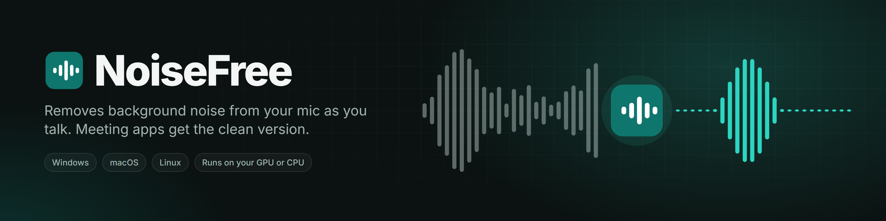
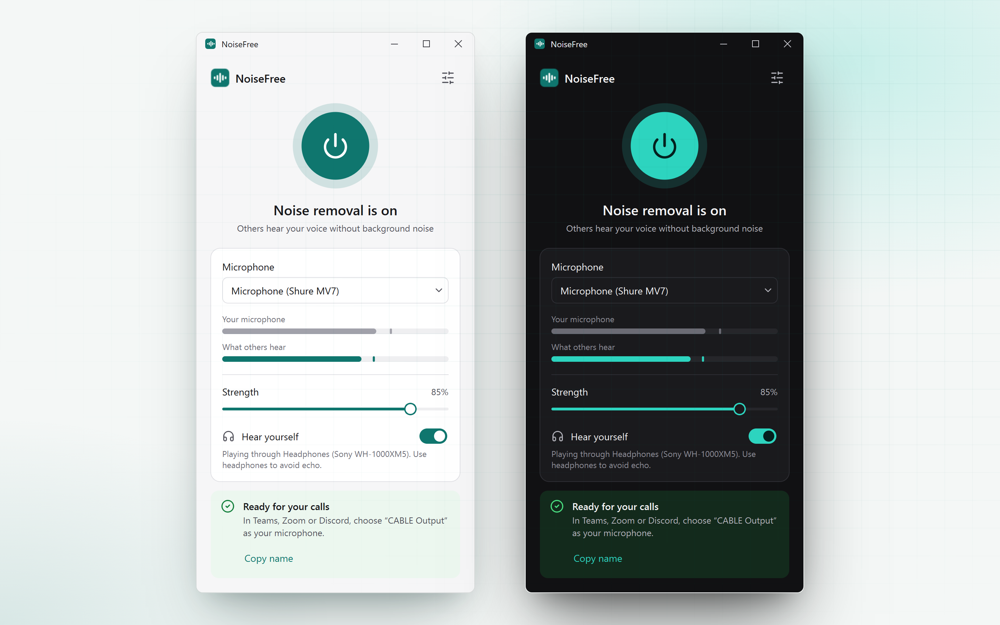
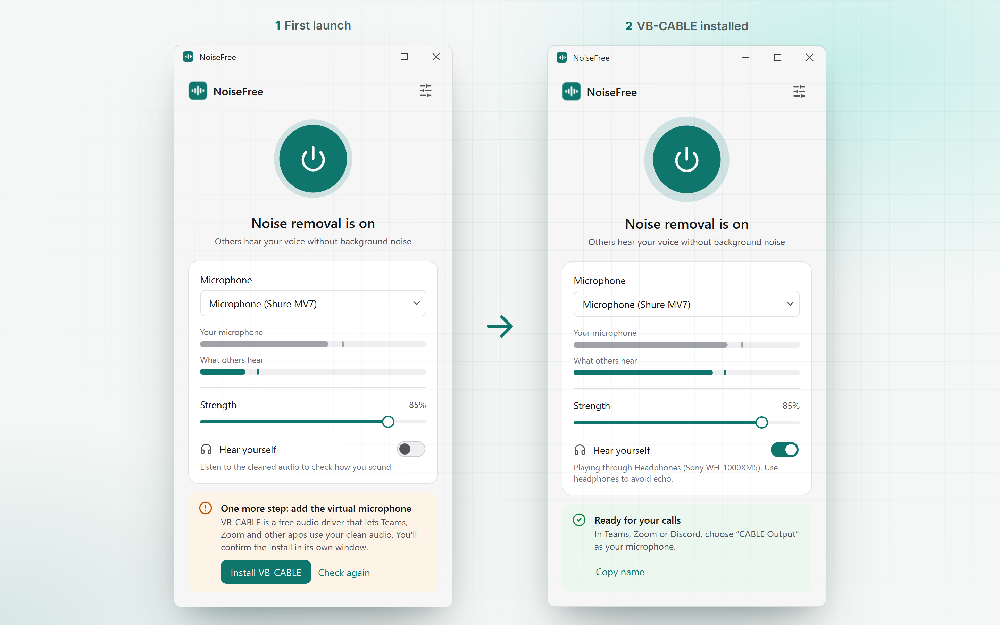
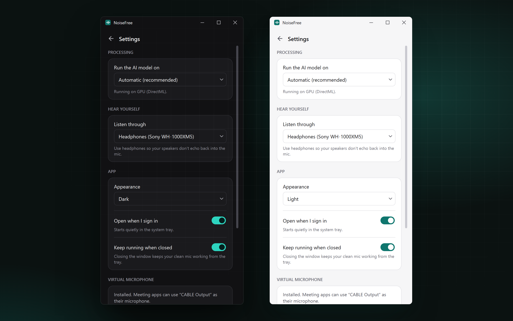

NoiseFree cleans up your microphone in real time and gives Teams, Zoom, Discord, OBS or any other app a virtual microphone that carries only your voice. It runs on Windows, macOS and Linux, and does all the processing on your own computer.

[](https://github.com/anand34577/noisefree/actions/workflows/ci.yml)




## Why

Fans, keyboards, traffic and the neighbour's drill all end up in your calls. NVIDIA Broadcast fixes that, but only on RTX cards and only on Windows. NoiseFree uses a small open model ([DTLN](https://github.com/breizhn/DTLN)) through ONNX Runtime, so it runs on almost any GPU, and on the CPU when there's no GPU to use.

## Features

- Removes noise with about 32 ms of model latency. The model is 4 MB and uses roughly 5 to 10% of one CPU core.
- Picks the fastest processor it can find: DirectML on Windows (any NVIDIA, AMD or Intel GPU), CUDA on Linux, Core ML on macOS. If that fails, it falls back to the CPU and tells you.
- Keeps the virtual mic alive when you switch noise removal off, so your meeting app never loses its input. Your raw voice just passes through.
- Shows two live meters, one for your mic and one for what other people hear, so you can see the noise drop.
- Has a strength slider for when full removal makes your voice sound thin.
- **Hear yourself** plays the cleaned audio back through your headphones.
- Installs the virtual cable from inside the app. On Linux it creates the cable itself, with no driver needed.
- Notices when you unplug a USB mic and reconnects when it comes back.
- Lives in the system tray, can start when you sign in, and follows your system's light or dark mode.

## Quick start

### Use the app

1. Download the file for your system from the [latest release](https://github.com/anand34577/noisefree/releases/latest): `NoiseFree.exe`, `NoiseFree-macOS.zip` or `NoiseFree-Linux-x64.tar.gz`.
2. Open it. On Windows and macOS, click **Install VB-CABLE** or **Install BlackHole** in the yellow box and follow the installer. Windows needs one restart afterwards.
3. In your meeting app's audio settings, pick the microphone NoiseFree names in its green box. That's **CABLE Output** on Windows, **BlackHole 2ch** on macOS and **NoiseFree Microphone** on Linux.



### Run from source

You need Python 3.10 or newer. On Linux, also install PortAudio with `sudo apt install libportaudio2`.

```bash
git clone https://github.com/anand34577/noisefree.git
cd noisefree
python -m venv .venv
```

Activate the environment. On Windows:

```powershell
.venv\Scripts\activate
```

On macOS or Linux:

```bash
source .venv/bin/activate
```

Then install and run:

```bash
pip install -r requirements.txt
python main.py
```

### Build a standalone app

```bash
pip install -r requirements-build.txt
python build.py
```

The result lands in `dist/`. On Windows it's a single `NoiseFree.exe` of about 77 MB. PyInstaller only builds for the system it runs on, so the [Build workflow](.github/workflows/build.yml) builds all three and publishes a GitHub release when you push a `v*` tag.

## Settings

There are no config files or environment variables. Everything lives in the app's Settings screen and is saved automatically.

| Setting | What it does | Default |
|---|---|---|
| Microphone | The physical mic to clean up. Opens a fresh device list each time, so newly plugged-in mics show up. | System default |
| Strength | Blend between cleaned (100%) and raw (0%) audio. | 100% |
| Run the AI model on | Automatic, a specific GPU provider, or CPU. | Automatic |
| Listen through | Output device for **Hear yourself**. | System default |
| Appearance | Match system, Light or Dark. | Match system |
| Open when I sign in | Starts NoiseFree in the tray when you log in. | Off |
| Keep running when closed | Closing the window hides it to the tray instead of quitting. | On |



## How it works

```
mic (any rate) → resample to 16 kHz → DTLN (ONNX) → resample → virtual cable → Teams / Zoom / …
                                                         └──→ headphones (Hear yourself)
```

Each device runs its own audio stream at its native sample rate. A small buffer per output absorbs the clock drift between devices. The [Architecture](docs/wiki/Architecture.md) page goes into detail.

## Limits

- Audio is processed as 16 kHz mono. That's normal for voice calls but not good enough for music or podcast recording.
- Windows needs VB-CABLE, a free third-party driver. Its licence doesn't allow bundling it inside another installer, so the app downloads the official package and you confirm the install in VB-CABLE's own window.
- Builds aren't code-signed yet. Windows SmartScreen and macOS Gatekeeper will warn the first time you open them; [Troubleshooting](docs/wiki/Troubleshooting.md) shows how to get past that.

## Documentation

The [wiki](docs/wiki/Home.md) has step-by-step setup for each OS, troubleshooting for the errors people actually hit, and notes for contributors.

## Credits

The noise removal model is [DTLN](https://github.com/breizhn/DTLN) by Nils L. Westhausen (MIT). The virtual cables are [VB-CABLE](https://vb-audio.com/Cable/) by VB-Audio on Windows and [BlackHole](https://github.com/ExistentialAudio/BlackHole) by Existential Audio on macOS. Full licence details are in [THIRD_PARTY_NOTICES.md](THIRD_PARTY_NOTICES.md).
