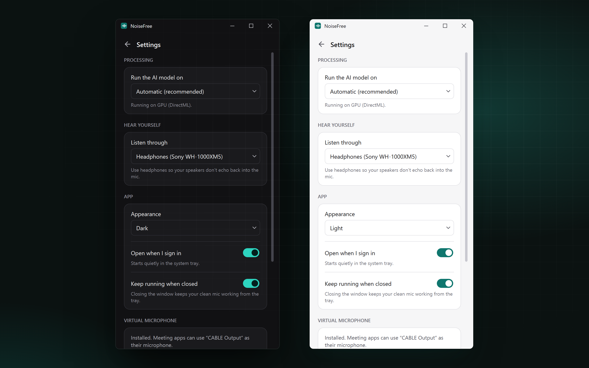

# Settings

NoiseFree has no config files or environment variables. Open Settings with the sliders icon at the top right (or Ctrl+,). Changes apply immediately and are saved.

## Processing

### Run the AI model on

| Option | When to pick it |
|---|---|
| Automatic (recommended) | Uses a GPU if one works, otherwise the CPU. |
| GPU (DirectML) | Windows. Works on NVIDIA, AMD and Intel graphics. |
| NVIDIA GPU (CUDA) | Linux, and only if you installed the `onnxruntime-gpu` package when running from source. |
| Apple GPU / Neural Engine (Core ML) | macOS. |
| CPU | Always available. The model is small enough that a CPU from the last ten years handles it fine. |

The line under the list says what NoiseFree is actually using, for example *Running on GPU (DirectML)*. If you picked a GPU and it failed to load, it says *The selected processor wasn't available, so NoiseFree is using the CPU* and keeps working.

The GPU isn't always faster for a model this small. On a GTX 1650 test machine, each 8 ms block took 0.9 ms on the GPU and 0.4 ms on the CPU. Pick the GPU to keep your CPU free during heavy work like screen sharing or compiling; pick the CPU if the GPU is busy with a game.

## Hear yourself

### Listen through

The headphones or speakers that **Hear yourself** plays to. The virtual cable is left out of this list on purpose, because choosing it would feed the audio back into itself.

## App

### Appearance

**Match system** follows your OS light/dark setting and switches when it does. **Light** and **Dark** stay fixed.

### Open when I sign in

Starts NoiseFree in the tray when you log in, without opening the window. Where it's stored:

- Windows: `HKEY_CURRENT_USER\Software\Microsoft\Windows\CurrentVersion\Run`, value `NoiseFree`
- macOS: `~/Library/LaunchAgents/com.noisefree.app.plist`
- Linux: `~/.config/autostart/noisefree.desktop`

### Keep running when closed

On (default): the window's close button hides NoiseFree to the tray, and your virtual mic keeps working. The first time, a notification reminds you it's still running.

Off: closing the window quits the app.

## Virtual microphone

Shows whether the virtual cable is installed, and offers **Install** or **Reinstall**. On Linux there's no button, because the cable is created when NoiseFree starts and removed when it quits.

## Where settings are saved

NoiseFree uses Qt's standard settings store, under the name `NoiseFree`:

- Windows: registry, `HKEY_CURRENT_USER\Software\NoiseFree\NoiseFree`
- macOS: a `.plist` in `~/Library/Preferences/`
- Linux: `~/.config/NoiseFree/NoiseFree.conf`

Deleting that key or file resets everything to defaults.
