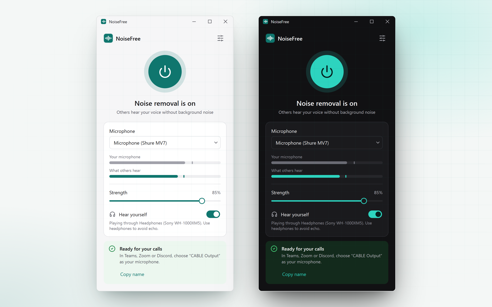

# NoiseFree

NoiseFree removes background noise from your microphone while you talk and hands the clean audio to your meeting apps through a virtual microphone. It's for anyone who takes calls somewhere that isn't quiet: a shared office, a home with a loud fan, a laptop with a noisy keyboard.

It works on Windows, macOS and Linux, on almost any computer. A graphics card helps but isn't required.

## Start here

1. [Installation](Installation): get the app and the virtual microphone driver onto your computer.
2. [Getting started](Getting-Started): your first call with NoiseFree, about five minutes.
3. [Using NoiseFree](Usage): what each control does and when to change it.
4. [Settings](Configuration): every option on the Settings screen.

If something isn't working, go straight to [Troubleshooting](Troubleshooting). Questions like "does my audio get uploaded?" are answered in the [FAQ](FAQ).

For contributors: [Architecture](Architecture) explains how the audio flows through the code, and [Building and releasing](Building-and-Releasing) covers making the standalone apps.
