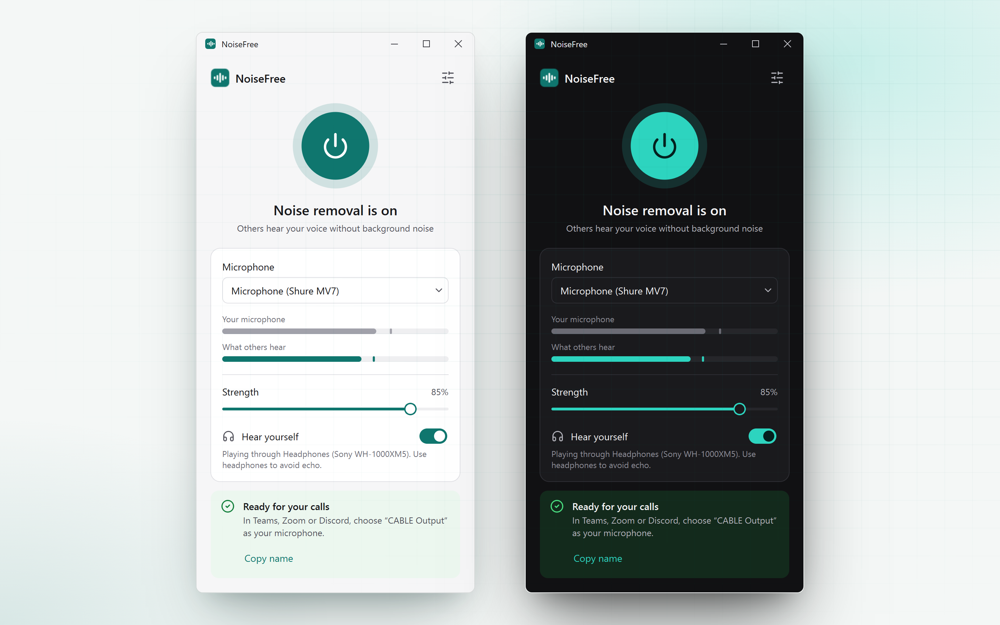

# Using NoiseFree

## The power button

The round button at the top left turns noise removal on and off. You can also click it from the keyboard: press Tab until it's outlined, then Space.

Switching it off doesn't disconnect anything. Your meeting app keeps getting audio from the virtual microphone; it's just your raw mic instead of the cleaned one. That means you can switch it off mid-call to let people hear something on purpose, like a guitar, without anyone having to change settings.

The ring around the button gets bigger as you speak. It follows the cleaned audio, so if it moves while you're silent, some noise is still getting through.

## Level meters

- **Your mic** (grey) is what your mic picks up, noise included.
- **Others hear** (teal) is what goes to the meeting app.

When you're quiet, the teal meter should sit near zero. Both meters use a decibel scale, so small bars mean quiet sounds, and a short line marks the recent peak.

## Strength

The slider blends the cleaned and original audio:

- **100%**: only the cleaned audio. Best in loud places.
- **70–85%**: lets a little room sound back in. Voices sound more natural, and it's a good setting for a quiet home office.
- **0%**: the same as turning noise removal off.

If people say you sound robotic or underwater, lower it in steps of 10.

## Hear yourself

Plays the cleaned audio back to you, so you can check what other people hear. Use headphones: through speakers, your mic picks up the playback and echoes. The output device is set in [Settings](Configuration#listen-through).

**Hear yourself** stays the way you left it, including after a restart. If you switch it on, switch it off again before you unplug your headphones.

## The status box

The box under the controls always tells you the one thing to do next:

| Colour | Message | Meaning |
|---|---|---|
| Green | Ready for your calls | Everything works. Pick the named mic in your meeting app. |
| Yellow | One more step: add the virtual microphone | The virtual cable driver isn't installed. Click the install button. |
| Yellow | Almost there | You've run the installer. Windows needs a restart; on macOS click **Check again**. |
| White | Downloading VB-CABLE… | The driver package is downloading. |
| Red | Microphone disconnected | The mic was unplugged. NoiseFree checks every few seconds and reconnects by itself. |
| Red | Couldn't open the microphone | The OS refused access. See [Troubleshooting](Troubleshooting). |

## The tray icon

NoiseFree keeps running in the system tray (the area by the clock on Windows and Linux, the menu bar on macOS). The icon is teal when noise removal is on and grey when it's off.

- Click the icon to open the window.
- Right-click it for **Noise removal** (on/off), **Open NoiseFree** and **Quit**.

Only **Quit** actually stops NoiseFree. After that, the virtual microphone goes silent until you open it again.

## Keyboard shortcuts

| Keys | Action |
|---|---|
| Tab / Shift+Tab | Move between controls |
| Space | Toggle the focused button or switch |
| Ctrl+, | Open Settings |
| Esc | Back from Settings |
